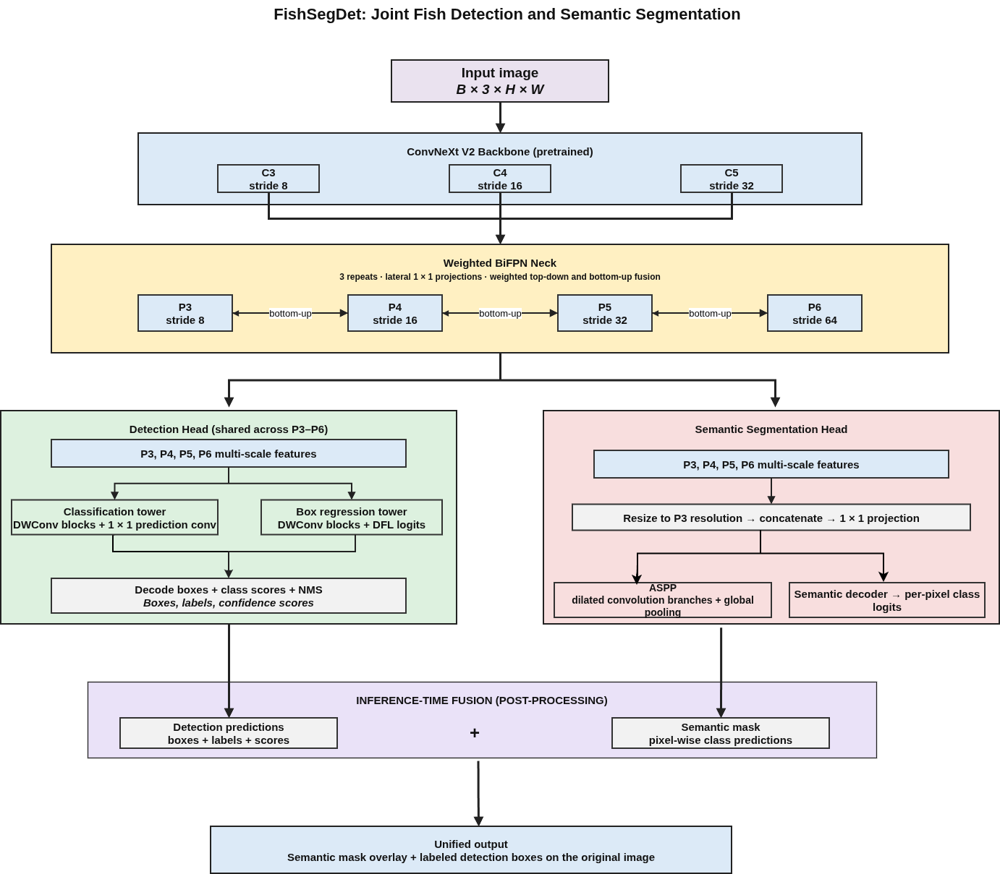

<div align="center">

# FishSegDet

### A Unified Framework for Joint Detection and Semantic Segmentation of Underwater Marine Species

[](https://www.python.org/)
[](https://pytorch.org/)
[](https://github.com/huggingface/pytorch-image-models)
[](https://github.com/LinHong-HIT/USIS16K)
[](LICENSE)

</div>

---

## The Problem

Detecting and segmenting objects in underwater imagery is substantially harder than in standard benchmarks. Water selectively absorbs red wavelengths, shifting colour toward blue-green and weakening the visual cues that ImageNet-pretrained models rely on. Turbidity, caustics, backscatter and camouflage further reduce contrast. Category coverage is also uneven: in USIS16K, the number of images per category ranges from 36 to 258.

Applications from autonomous underwater vehicles to marine biodiversity monitoring need both **bounding boxes** (for counting and tracking) and **pixel-level masks** (for biomass estimation and morphometric analysis). Treating these as separate problems duplicates computation and ignores the signal each task provides to the other.

FishSegDet produces both outputs in a single forward pass.

---

## What It Does

FishSegDet is a **single-stage model** that simultaneously:

- Predicts a bounding box for every object in the frame, regressing each box side as a discrete distribution trained with **Distribution Focal Loss**
- Classifies each box with **IoU-aware soft labels**, so the confidence score also estimates localization quality, not just category recognition
- Produces a full-resolution semantic segmentation mask with a **multi-level fusion + ASPP** decoder
- Applies underwater-specific preprocessing (white balance → CLAHE → gamma) to every input image, at both training and inference time

It is trained on **USIS16K** with a three-phase curriculum and class-balanced sampling.

---

## Architecture

### Overview



### Component Diagrams

<table>
  <tr>
    <td align="center" width="50%">
      <b>Backbone — ConvNeXtV2-Large</b><br><br>
      
    </td>
    <td align="center" width="50%">
      <b>Neck — BiFPN (×3 repeats, 256ch, P3–P6)</b><br><br>
      
    </td>
  </tr>
  <tr>
    <td align="center" colspan="2">
      <b>Heads — DFL Detection (TAL + IoU-aware cls) &amp; Multi-level + ASPP Segmentation</b><br><br>
      
    </td>
  </tr>
</table>

### Design Decisions

| Component | Choice | Why |
|---|---|---|
| Backbone | ConvNeXtV2-Large (FCMAE, IN-22K → IN-1K @ 384) | Strong convolutional inductive bias for dense prediction; FCMAE pre-training has been shown to transfer well to detection and segmentation |
| Neck | BiFPN × 3, 256ch, P3–P6 | Bidirectional fusion with learnable, normalised weights; 4 levels at strides 8–64 cover objects from a few pixels up to full-frame |
| Detection | DFL, reg\_max=16, shared decoupled head | Models each box side as a probability distribution over discrete offsets, which represents the localisation ambiguity of blurred underwater edges |
| Assignment | TAL, topk=13, α=0.5, β=6 | Joint alignment metric (cls^α × IoU^β) selects anchors that are both well-classified and well-localised, rather than relying on spatial rules alone |
| Classification | IoU-aware soft labels (varifocal-style weighting) | Training target = IoU of the predicted box, so sigmoid(cls) learns to rank detections by localisation quality; no separate centerness branch is needed |
| Box loss | CIoU (λ=3) | Penalises centre distance and aspect-ratio deviation, not just overlap area |
| Segmentation | P3–P6 fusion + ASPP, ×8 upsampling decoder | ASPP (dilations 1, 6, 12, 18 + image-level pooling) captures multi-scale context without losing resolution |
| Seg loss | CE (label smoothing 0.05) + Dice, λ=1.5 | Dice directly optimises region overlap; CE provides per-pixel supervision |

---

## Training Strategy

### 3-Phase Curriculum

| Phase | Epochs | Backbone | Augmentation | Backbone LR | Head LR |
|---|---|---|---|---|---|
| 1 | 60 | Frozen | Geometry + mild colour | — | 3e-4 |
| 2 | 40 | Unfrozen | Heavy (mosaic, fog, motion blur, coarse dropout) | 2e-5 | 3e-4 |
| 3 | 40 | Unfrozen | Same as Phase 2 (fresh optimiser and schedule) | 2e-5 | 3e-4 |

**Rationale:** Freezing the backbone in Phase 1 lets the randomly initialised neck and heads stabilise before their gradients reach the pre-trained features. The lower backbone learning rate in Phases 2–3 limits drift away from the pre-trained representations. Phase 3 restarts the schedule, acting as a warm restart.

### Additional Training Details

- **Scheduler:** linear warm-up (10 epochs in Phase 1, 8 in Phases 2–3), then cosine decay to zero; restarted at each phase
- **Class-balanced sampler:** per-image weight = 1/√freq of the rarest class in the image, sampled with replacement
- **Mosaic augmentation:** 4-image mosaic on half of the samples in Phases 2–3, exposing the model to fragmented objects and varied scales
- **Optimiser:** AdamW with fused CUDA kernels, weight decay 0.05, gradient clipping at norm 10
- **AMP + GradScaler:** mixed precision on every forward/backward pass
- **EMA:** exponential moving average (decay 0.9999) kept on a CPU shadow copy and saved in each checkpoint as `ema_state_dict`

---

## Dataset

[USIS16K](https://github.com/LinHong-HIT/USIS16K) contains 16,151 underwater images covering 158 object categories, with box and instance-mask annotations. The official splits contain 11,306 training, 3,230 validation and 1,615 test images.

---

## Results on USIS16K

FishSegDet is compared with two YOLO segmentation models on the USIS16K test split. All models produce both bounding-box detections and segmentation masks.

| Model | Params | mAP | mAP₅₀ | mIoU | Dice | Precision | Recall | Pixel Acc |
|---|---|---|---|---|---|---|---|---|
| [YOLOv10l-seg](https://github.com/THU-MIG/yolov10) | ~24.4 M | 64.10 % | 85.50 % | 84.32 % | 83.92 % | 82.40 % | 85.50 % | 91.00 % |
| [YOLO11l-seg](https://docs.ultralytics.com/models/yolo11/) | ~27.71 M | 67.30 % | 88.00 % | 86.45 % | 86.12 % | 85.27 % | 87.00 % | 93.25 % |
| **FishSegDet (Ours)** | **204.75 M** | **74.34 %** | **97.73 %** | **94.41 %** | **95.84 %** | **95.88 %** | **96.04 %** | **99.30 %** |

FishSegDet outperforms both baselines on every metric. Against YOLO11l-seg, the stronger baseline, it gains **+7.04 pp mAP**, **+9.73 pp mAP₅₀**, **+7.96 pp mIoU**, **+9.72 pp Dice** and **+6.05 pp pixel accuracy**. This comes at a substantially larger model size: 204.75 M parameters versus 27.71 M, most of which (196.4 M) are in the ConvNeXtV2-Large backbone.

---

## Ablation Study

Evaluated on the USIS16K test split. Each row changes one design decision and keeps everything else at the full configuration.

| Configuration | mAP | mAP₅₀ | mIoU | Dice | Prec | Rec | PA |
|---|---|---|---|---|---|---|---|
| w/ ConvNeXtV2-Tiny backbone | 56.88 % | 91.87 % | 92.00 % | 93.06 % | 93.61 % | 93.75 % | 99.00 % |
| w/ ConvNeXtV2-Small backbone | 67.98 % | 94.27 % | 92.62 % | 93.99 % | 94.49 % | 93.94 % | 99.07 % |
| w/o BiFPN neck (plain FPN) | 44.77 % | 85.46 % | 91.52 % | 91.96 % | 92.27 % | 93.35 % | 98.85 % |
| w/o pretrained backbone | 35.53 % | 58.88 % | 59.38 % | 68.64 % | 72.46 % | 67.94 % | 96.33 % |
| **FishSegDet — full model** | **74.34 %** | **97.73 %** | **94.41 %** | **95.84 %** | **95.88 %** | **96.04 %** | **99.30 %** |

**Key findings:**

- **Pre-training is the most important factor.** Training from random initialisation drops mAP by **38.81 pp** and mIoU by **35.03 pp**, the largest degradation in the study. Although underwater imagery is visually far from ImageNet, the pre-trained features remain an essential starting point.

- **BiFPN is the most important architectural component.** Replacing it with a plain top-down FPN reduces mAP by **29.57 pp** (74.34 → 44.77) while segmentation metrics change far less (mIoU 94.41 → 91.52). This indicates that bidirectional weighted fusion matters most for box-level localisation across scales.

- **Backbone capacity mainly affects detection.** ConvNeXtV2-Large, Small and Tiny reach mAP of 74.34 / 67.98 / 56.88, a **17.46 pp spread**, while mIoU stays within 2.41 pp (94.41 / 92.62 / 92.00). Detection benefits most from the larger backbone, which motivates the choice of the Large variant.

---

## Visual Results

Each panel shows **Input image · Ground truth mask · Model prediction** (segmentation overlay + bounding boxes).

<table>
  <tr>
    <td align="center">
      <b>Atlantic Spadefish</b><br>
      
    </td>
  </tr>
  <tr>
    <td align="center">
      <b>Chromis Dimidiata</b><br>
      
    </td>
  </tr>
  <tr>
    <td align="center">
      <b>Common Octopus</b><br>
      
    </td>
  </tr>
  <tr>
    <td align="center">
      <b>Convict Surgeonfish</b><br>
      
    </td>
  </tr>
  <tr>
    <td align="center">
      <b>Dolphin</b><br>
      
    </td>
  </tr>
  <tr>
    <td align="center">
      <b>Enoplosus Armatus</b><br>
      
    </td>
  </tr>
</table>

---

## Quick Start

### Installation

```bash
git clone https://github.com/<your-username>/FishSegDet.git
cd FishSegDet
pip install -r requirements.txt
```

Requires Python ≥ 3.9, PyTorch ≥ 2.3, CUDA 11.8+.

### Dataset Layout

```
USIS16K/
├── train/                          # training images
├── val/                            # validation images
├── test/                           # test images
└── annotations/
    ├── instances_train.json
    ├── instances_val.json
    └── instances_test.json
```

Class names are read from the annotation file automatically; no manual configuration is required.

### Train

```bash
# Default: ConvNeXtV2-Large, 640px, USIS16K
python train.py --data ./USIS16K --device cuda

# Faster backbone for iteration
python train.py --data ./USIS16K --backbone convnextv2_tiny.fcmae_ft_in22k_in1k

# Initialise from a checkpoint (loads weights; training starts again from Phase 1)
python train.py --data ./USIS16K --resume runs/fishsegdet_<timestamp>/best.pt

# Gradient accumulation (for smaller GPUs)
python train.py --data ./USIS16K --batch-size 8 --accum-steps 2
```

Checkpoints, a CSV metrics log and optional TensorBoard logs are written to `runs/fishsegdet_<timestamp>/`.

### Evaluate

```bash
# Full test-set evaluation with per-class breakdown
python test.py --weights runs/fishsegdet_<timestamp>/best.pt --data ./USIS16K --eval

# Evaluation + save overlay visualisations
python test.py --weights runs/fishsegdet_<timestamp>/best.pt --data ./USIS16K --eval --save-vis
```

### Inference

```bash
# Single image — displays the result in a window
python test.py --weights best.pt --image sample.jpg

# Folder — saves overlays to ./results/
python test.py --weights best.pt --folder ./images/ --out-dir ./results/
```

### Publication Figures

```bash
# One representative image per class, IEEE/Springer layout
python visualization_pub.py --weights best.pt --data ./USIS16K

# Camera-ready PDF at 600 dpi
python visualization_pub.py --weights best.pt --data ./USIS16K --format pdf --dpi 600
```

---

## Project Structure

```
FishSegDet/
├── fishsegdet/                     # installable Python package
│   ├── config.py                   # Config dataclass · CFG singleton · class maps
│   ├── models/
│   │   ├── blocks.py               # ConvBN, DWConv  (shared primitives)
│   │   ├── backbone.py             # TimmBackbone  (any timm model, default ConvNeXtV2-L)
│   │   ├── neck.py                 # BiFPN  (weighted bidirectional FPN)
│   │   ├── heads.py                # DetectHead (DFL) · ASPP · FPNSegHead
│   │   └── detector.py             # FishSegDet · build_model()
│   ├── data/
│   │   ├── preprocessing.py        # UnderwaterPreprocessor  (WB → CLAHE → γ)
│   │   ├── augmentations.py        # get_train · get_val · get_heavy transforms
│   │   ├── datasets.py             # USISDataset (COCO) · MosaicDataset
│   │   └── loaders.py              # configure_dataset() · create_dataloaders()
│   ├── losses/
│   │   └── detection.py            # FishSegDetLoss  (TAL · DFL · IoU-aware cls · CE + Dice)
│   └── engine/
│       └── inference.py            # FishSegDetInference  (preprocess · decode · NMS · visualise)
├── train.py                        # training entry point
├── test.py                         # evaluation and inference entry point
├── visualization_pub.py            # publication-quality qualitative results
├── requirements.txt
└── README.md
```

---

## Requirements

```
torch>=2.3.0       torchvision>=0.18.0    timm>=0.9.0
albumentations>=2.0.0    opencv-python>=4.7.0    pycocotools>=2.0.6
torchmetrics>=1.0.0      numpy>=1.24.0      tqdm>=4.65.0
matplotlib>=3.7.0  tensorboard (optional)
```

---

## License

[MIT](LICENSE)
