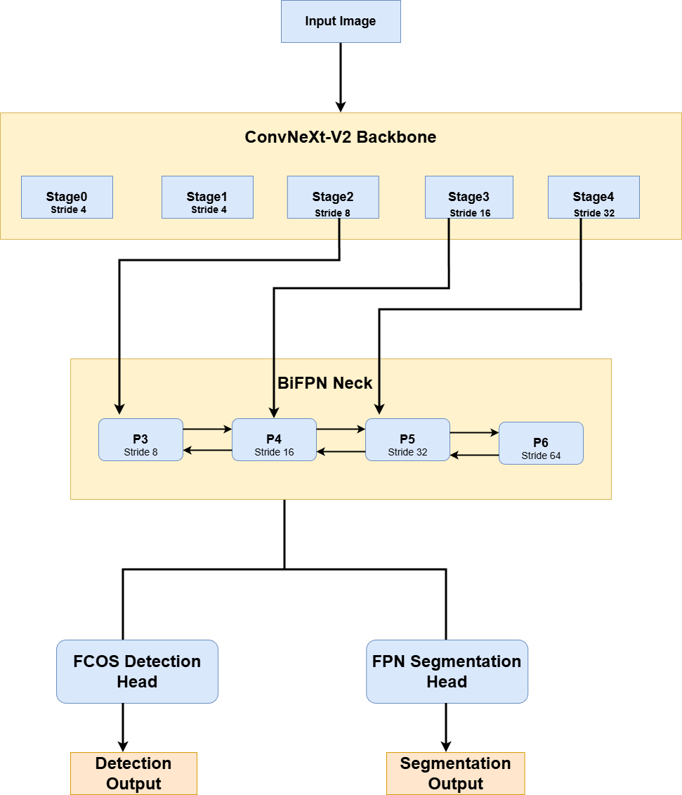
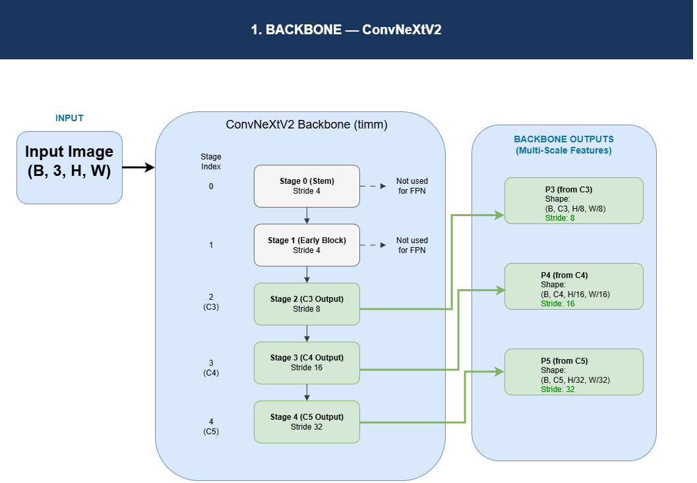
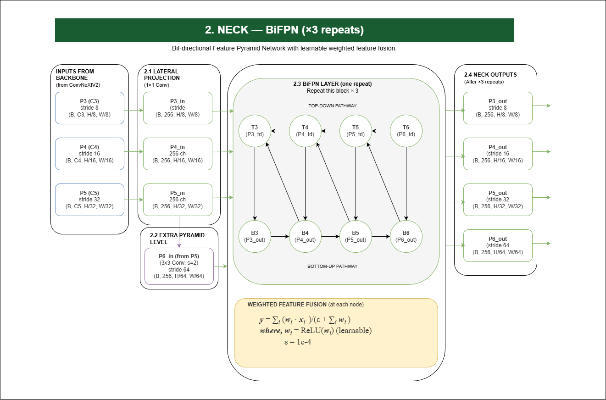
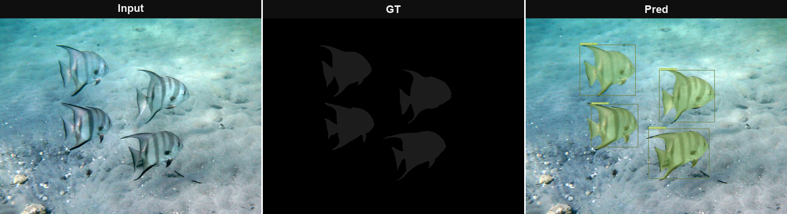
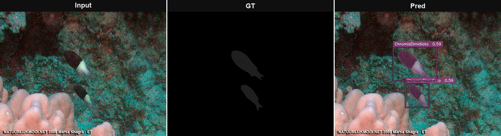
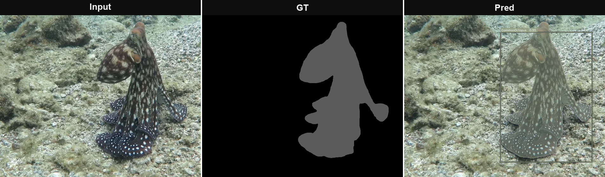
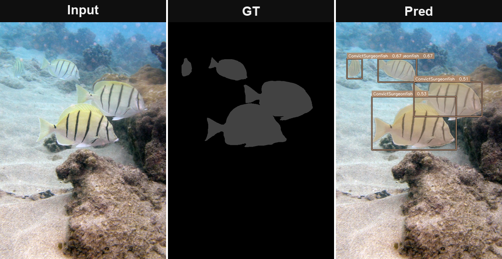
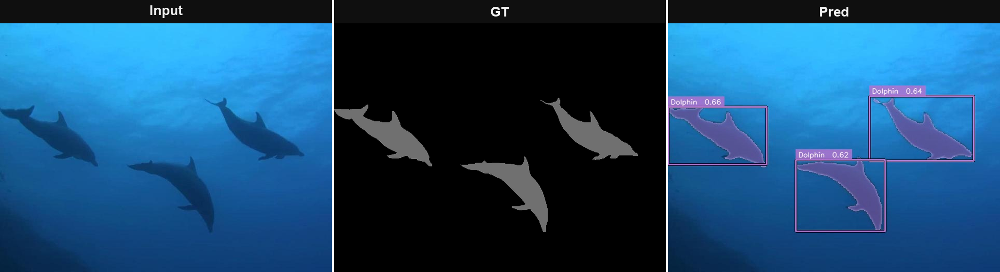
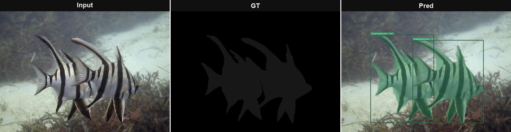

<div align="center">

# FishSegDet

### A Unified Framework for Joint Detection and Semantic Segmentation of Underwater Marine Species

[](https://www.python.org/)
[](https://pytorch.org/)
[](https://github.com/huggingface/pytorch-image-models)
[](https://github.com/LiamLian0852/USIS10K)
[](LICENSE)

</div>

---

## The Problem

Detecting and segmenting fish in underwater imagery is substantially harder than in standard benchmarks. Water selectively absorbs red wavelengths, shifting colour toward blue-green and destroying the visual cues models pre-trained on ImageNet rely on. Turbidity, caustics, backscatter, and camouflage further degrade contrast, while class imbalance is severe — common species appear thousands of times, rare ones a handful. Applications from autonomous underwater vehicles to marine biodiversity monitoring require **both bounding-box localisation** (for tracking) **and pixel-level masks** (for biomass estimation, morphometric analysis) — treating them as separate problems is inefficient and ignores the signal each task provides to the other.

FishSegDet addresses all of this in a single forward pass.

---

## What It Does

FishSegDet is a **single-stage, end-to-end model** that simultaneously:

- Predicts bounding boxes for every marine animal in the frame using **Distribution Focal Loss** regression
- Assigns each box to a class using **IoU-aware soft labels**, so the confidence score reflects localisation quality, not just category recognition
- Produces a full-resolution semantic segmentation mask via an **FPN + ASPP** decoder
- Runs underwater-specific preprocessing (white balance → CLAHE → gamma) before any augmentation

Trained end-to-end on **USIS16K** with a 3-phase curriculum strategy and class-balanced sampling.

---

## Architecture

### Overview



### Component Diagrams

<table>
  <tr>
    <td align="center" width="50%">
      <b>Backbone — ConvNeXtV2-Large</b><br><br>
      
    </td>
    <td align="center" width="50%">
      <b>Neck — BiFPN (×3 repeats, 256ch, P3–P6)</b><br><br>
      
    </td>
  </tr>
  <tr>
    <td align="center" colspan="2">
      <b>Heads — DFL Detection (TAL + IoU-aware cls) &amp; FPN+ASPP Segmentation</b><br><br>
      
    </td>
  </tr>
</table>

### Design Decisions

| Component | Choice | Why |
|---|---|---|
| Backbone | ConvNeXtV2-Large | Pure-conv architecture maintains translation equivariance critical for detecting fish at arbitrary positions; FCMAE pre-training is superior for dense prediction |
| Neck | BiFPN × 3, 256ch, P3–P6 | Bidirectional fusion with learnable weights outperforms top-down-only FPN; 4 levels cover strides 8–64 for fish from a few pixels to full-frame |
| Detection | DFL, reg\_max=16 | Models box regression as a probability distribution over discrete offsets — directly captures the localisation ambiguity caused by blurry underwater edges |
| Assignment | TAL, topk=13 | Joint cls–reg alignment metric (cls^α × IoU^β) selects anchors that are simultaneously well-classified and well-localised, unlike FCOS which uses a fixed spatial radius |
| Classification | IoU-aware soft labels | Training target = IoU value; inference score = sigmoid(cls) × predicted\_IoU, so high-confidence detections are guaranteed to be well-localised |
| Box loss | CIoU | Penalises centre-distance and aspect-ratio deviation, not just overlap area |
| Segmentation | FPN + ASPP + prototype | ASPP dilations (6, 12, 18, global) capture multi-scale context without the resolution loss of pooling |
| Seg loss | CE + Dice (λ=1.5) | Dice directly optimises the F1-overlap metric; CE provides per-pixel supervision |

---

## Training Strategy

### 3-Phase Curriculum

| Phase | Epochs | Backbone | Augmentation | Backbone LR | Head LR |
|---|---|---|---|---|---|
| 1 | 60 | Frozen | Geometry + mild colour | — | 3e-4 |
| 2 | 40 | Unfrozen | Heavy (mosaic, fog, motion blur, coarse dropout) | 2e-5 | 3e-4 |
| 3 | 40 | Unfrozen | Same as Phase 2 | 2e-5 | 3e-4 |

**Rationale:** Freezing the backbone in Phase 1 prevents the pre-trained features from being corrupted before the randomly-initialised heads have stabilised. Differential learning rates in Phases 2–3 prevent catastrophic forgetting of the ImageNet representations.

### Additional Training Details

- **Scheduler:** 10-epoch cosine warm-up → cosine annealing decay per phase
- **Class-balanced sampler:** Per-sample weight = 1/√class\_freq of the rarest class in the image. Prevents the model from ignoring rare marine species.
- **Mosaic augmentation:** 4-image mosaic (Phase 2+) — forces the model to handle fragmented objects and non-standard scales.
- **Optimiser:** AdamW with fused CUDA kernels, weight decay 0.05
- **AMP + GradScaler:** Mixed precision on every forward/backward
- **EMA:** Exponential moving average (decay=0.9999) on a CPU shadow copy; final checkpoint uses EMA weights

---

## Results on USIS16K

FishSegDet is evaluated against two strong YOLO baselines of comparable scale on the USIS16K test split. All models produce both bounding-box detections and segmentation masks.

| Model | Params | mAP | mAP₅₀ | mIoU | Dice | Precision | Recall | Pixel Acc |
|---|---|---|---|---|---|---|---|---|
| YOLOv10l-seg \[64\] | ~24.4 M | 64.10 % | 85.50 % | 84.32 % | 83.92 % | 82.40 % | 85.50 % | 91.00 % |
| YOLOv11l-seg \[65\] | ~27.71 M | 67.30 % | 88.00 % | 86.45 % | 86.12 % | 85.27 % | 87.00 % | 93.25 % |
| **FishSegDet (Ours)** | **204.75 M** | **74.34 %** | **97.73 %** | **94.41 %** | **95.84 %** | **95.88 %** | **96.04 %** | **99.30 %** |

FishSegDet sets a new best on every metric. Against YOLOv11l-seg — the strongest baseline — it achieves **+7.04 pp mAP**, **+9.73 pp mAP₅₀**, **+7.96 pp mIoU**, **+9.72 pp Dice**, and **+6.05 pp PA**, while using 204.75 M parameters compared to 27.71 M. The 99.30 % pixel accuracy reflects near-perfect background suppression even in turbid, low-contrast underwater conditions.

---

## Ablation Study

Evaluated on the USIS16K test split (159 classes). Each row isolates the contribution of one design decision while keeping everything else at full configuration.

| Configuration | mAP | mAP₅₀ | mIoU | Dice | Prec | Rec | PA |
|---|---|---|---|---|---|---|---|
| w/ ConvNeXtV2-Tiny backbone | 56.88 % | 91.87 % | 92.00 % | 93.06 % | 93.61 % | 93.75 % | 99.00 % |
| w/ ConvNeXtV2-Small backbone | 67.98 % | 94.27 % | 92.62 % | 93.99 % | 94.49 % | 93.94 % | 99.07 % |
| w/o BiFPN neck (plain FPN) | 44.77 % | 85.46 % | 91.52 % | 91.96 % | 92.27 % | 93.35 % | 98.85 % |
| w/o pretrained backbone | 35.53 % | 58.88 % | 59.38 % | 68.64 % | 72.46 % | 67.94 % | 96.33 % |
| **FishSegDet — full model** | **74.34 %** | **97.73 %** | **94.41 %** | **95.84 %** | **95.88 %** | **96.04 %** | **99.30 %** |

**Key findings:**

- **BiFPN is the single largest contributor.** Replacing it with a plain top-down FPN causes a **−29.57 pp drop in mAP** (74.34 → 44.77), the largest degradation of any ablated component. Bidirectional weighted fusion is essential for handling fish that span multiple scales simultaneously.

- **ImageNet pre-training is critical for underwater transfer.** Training from random initialisation drops mAP by **−38.81 pp** and mIoU by **−35.03 pp**. The underwater domain is visually far from ImageNet, yet the pre-trained features still provide an indispensable starting point — without them the model fails to converge to competitive segmentation quality.

- **Backbone capacity scales detection directly.** ConvNeXtV2-Large vs Small vs Tiny produces mAP of 74.34 / 67.98 / 56.88 — a **17.46 pp spread** across three backbone sizes — while segmentation metrics (mIoU 94.41 / 92.62 / 92.00) remain comparatively stable. This confirms that detection is the bottleneck and justifies the choice of the Large variant.

---

## Visual Results

Each panel shows **Input image · Ground truth mask · Model prediction** (segmentation overlay + bounding box).

<table>
  <tr>
    <td align="center">
      <b>Atlantic Spadefish</b><br>
      
    </td>
  </tr>
  <tr>
    <td align="center">
      <b>Chromis Dimidiata</b><br>
      
    </td>
  </tr>
  <tr>
    <td align="center">
      <b>Common Octopus</b><br>
      
    </td>
  </tr>
  <tr>
    <td align="center">
      <b>Convict Surgeonfish</b><br>
      
    </td>
  </tr>
  <tr>
    <td align="center">
      <b>Dolphin</b><br>
      
    </td>
  </tr>
  <tr>
    <td align="center">
      <b>Enoplosus Armatus</b><br>
      
    </td>
  </tr>
</table>

---

## Quick Start

### Installation

```bash
git clone https://github.com/<your-username>/FishSegDet.git
cd FishSegDet
pip install -r requirements.txt
```

Requires Python ≥ 3.9, PyTorch ≥ 2.0, CUDA 11.8+.

### Dataset Layout

```
USIS16K/
├── train/                          # training images
├── val/                            # validation images
├── test/                           # test images
└── annotations/
    ├── instances_train.json
    ├── instances_val.json
    └── instances_test.json
```

Class names are read from the annotation file automatically — no manual configuration required.

### Train

```bash
# Default: ConvNeXtV2-Large, 640px, USIS16K
python train.py --data ./USIS16K --device cuda

# Faster backbone for iteration
python train.py --data ./USIS16K --backbone convnextv2_tiny.fcmae_ft_in22k_in1k

# Resume from checkpoint
python train.py --data ./USIS16K --resume runs/fishsegdet_20240901/best.pt

# Gradient accumulation (for smaller GPUs)
python train.py --data ./USIS16K --batch-size 8 --accum-steps 2
```

Checkpoints, CSV metrics log, and optional TensorBoard logs are written to `runs/fishsegdet_<timestamp>/`.

### Evaluate

```bash
# Full test-set evaluation with per-class breakdown
python test.py --weights runs/fishsegdet_20240901/best.pt --data ./USIS16K --eval

# Evaluation + save overlay visualisations
python test.py --weights runs/fishsegdet_20240901/best.pt --data ./USIS16K --eval --save-vis
```

### Inference

```bash
# Single image — displays result in a window
python test.py --weights best.pt --image sample.jpg

# Folder — saves overlays to ./results/
python test.py --weights best.pt --folder ./images/ --out-dir ./results/
```

### Publication Figures

```bash
# One representative image per class, IEEE/Springer layout
python visualization_pub.py --weights best.pt --data ./USIS16K

# Camera-ready PDF at 600 dpi
python visualization_pub.py --weights best.pt --data ./USIS16K --format pdf
```

---

## Project Structure

```
FishSegDet/
├── fishsegdet/                     # installable Python package
│   ├── config.py                   # Config dataclass · CFG singleton · class maps
│   ├── models/
│   │   ├── blocks.py               # ConvBN, DWConv  (shared primitives)
│   │   ├── backbone.py             # TimmBackbone  (any timm model, default ConvNeXtV2-L)
│   │   ├── neck.py                 # BiFPN  (weighted bidirectional FPN)
│   │   ├── heads.py                # DetectHead (DFL) · ASPP · FPNSegHead
│   │   └── detector.py             # FishSegDet · build_model()
│   ├── data/
│   │   ├── preprocessing.py        # UnderwaterPreprocessor  (WB → CLAHE → γ)
│   │   ├── augmentations.py        # get_train · get_val · get_heavy transforms
│   │   ├── datasets.py             # USISDataset (COCO) · MosaicDataset
│   │   └── loaders.py              # configure_dataset() · create_dataloaders()
│   ├── losses/
│   │   └── detection.py            # FishSegDetLoss  (TAL · DFL · IoU-aware · Dice)
│   └── engine/
│       └── inference.py            # FishSegDetInference  (preprocess · decode · NMS · visualise)
├── train.py                        # training entry point
├── test.py                         # evaluation and inference entry point
├── visualization_pub.py            # publication-quality qualitative results
├── requirements.txt
└── README.md
```

---

## Requirements

```
torch>=2.0.0       torchvision>=0.15.0    timm>=0.9.0
albumentations>=1.3.0    opencv-python>=4.7.0    pycocotools>=2.0.6
numpy>=1.24.0      tqdm>=4.65.0           matplotlib>=3.7.0
```

---

## License

[MIT](LICENSE)
